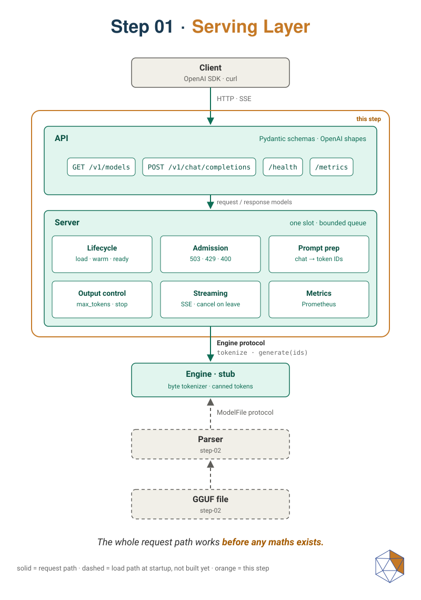
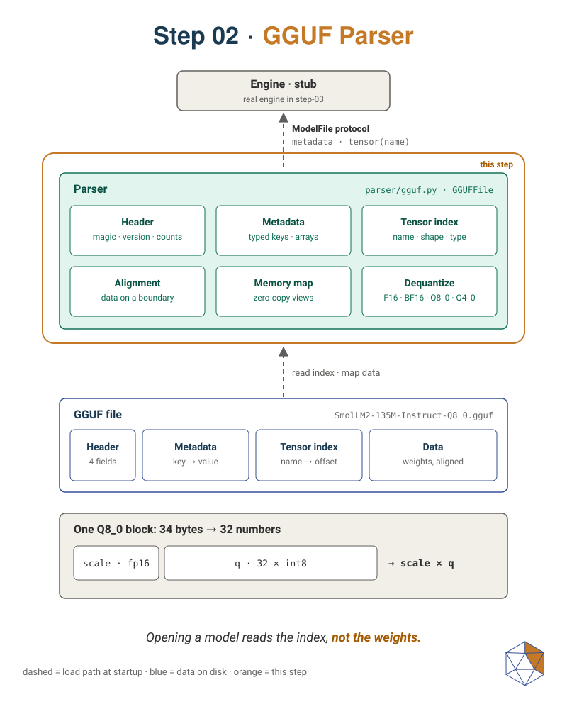
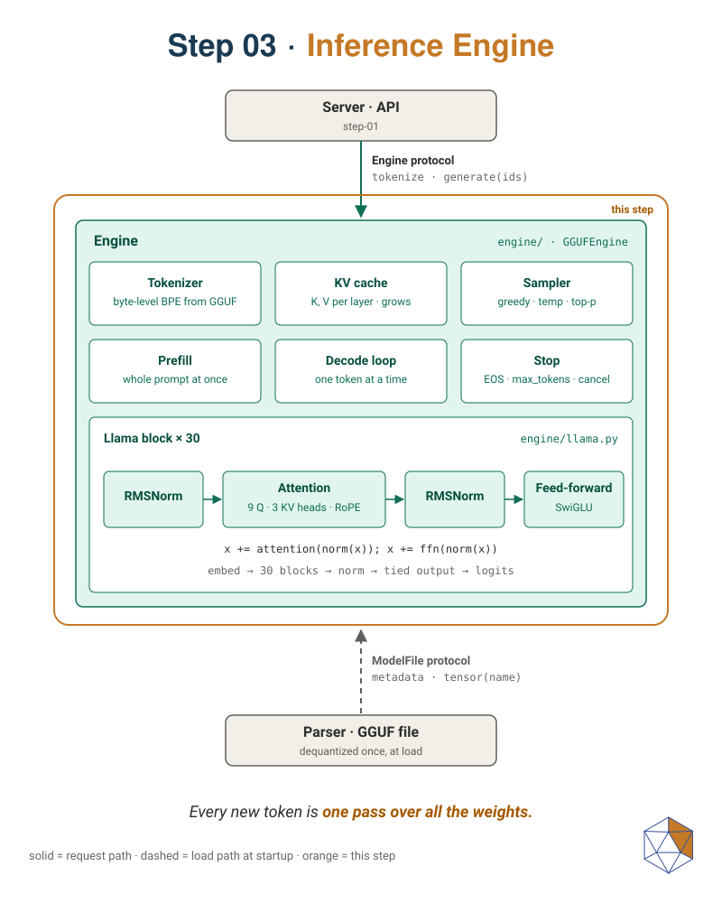

# local-ai-inference

A custom implementation of the local AI inference stack: a GGUF **parser**, a NumPy **engine**,
a **server** and an OpenAI-compatible **API**, built one layer at a time.

> A custom server, not a production one. It serves one request at a time on purpose, so each
> layer stays small enough to understand.

## Quick start

Requires [uv](https://docs.astral.sh/uv/).

```bash
uv sync                    # create .venv, install dependencies and dev tools
uv run pytest              # fast tests
uv run ruff check .        # lint
uv run ruff format .       # format
uv run local-ai-inference        # start the server on http://127.0.0.1:8000
uv run local-ai-inference inspect <file.gguf>   # summarise a model file
uv run local-ai-inference serve --model <file.gguf>   # serve a real model
```

Tests that need a real model file are marked `model` and skipped by default:

```bash
uv run pytest -m model
```

## Steps

Each step is a git tag, so you can check out the repo at any stage. Every section below starts
by checking out its tag, so the commands match the code you have:

```bash
git clone https://github.com/Felix-Mutinda/local-ai-inference.git
cd local-ai-inference
git checkout step-01        # or any step tag
uv sync
```

Run `git checkout main` to return to the latest code.

| Tag | Step | Status |
|---|---|---|
| `step-00` | Tooling: uv, ruff, pytest, CI | done |
| `step-01` | Serving layer: API + server + stub engine | done |
| `step-02` | Parser: GGUF reader | done |
| `step-03` | Engine: forward pass, KV cache, sampler | done |
| `step-04` | Measure: metrics, memory, cold vs warm, parity | next |

## Step 01: serving layer



The whole request path works before any maths exists. A stub engine replays a fixed reply
through a real byte-level tokenizer, so the API, the server and the boundaries between them can
be built and tested first. Step 03 swaps in the real engine behind the same `Engine` protocol.

**What each layer owns**

| Layer | Owns | Code |
|---|---|---|
| API | Routes, OpenAI request/response shapes, error format | `api/routes.py`, `api/schemas.py` |
| Server | Lifecycle, admission, prompt prep, output control, streaming, metrics | `server/` |
| Engine | Tokens in, tokens out | `engine/protocol.py`, `engine/stub.py` |
| Parser | Reading the model file (step-02) | `parser/__init__.py` (protocol only) |

**Try it**

```bash
git checkout step-01
uv sync
uv run local-ai-inference

# in another terminal
curl -s localhost:8000/health
curl -s localhost:8000/v1/models
curl -sN localhost:8000/v1/chat/completions \
  -H 'content-type: application/json' \
  -d '{"model": "stub-echo", "messages": [{"role": "user", "content": "Hi"}], "stream": true}'
curl -s localhost:8000/metrics | grep '^lai_'
```

Or with the OpenAI SDK, unchanged:

```python
from openai import OpenAI

client = OpenAI(base_url="http://127.0.0.1:8000/v1", api_key="unused")
reply = client.chat.completions.create(
    model="stub-echo", messages=[{"role": "user", "content": "Hi"}]
)
print(reply.choices[0].message.content)
```

**API contract**

| Route | Behaviour |
|---|---|
| `GET /v1/models` | The one loaded model |
| `POST /v1/chat/completions` | Supports `messages`, `max_tokens` / `max_completion_tokens`, `temperature`, `top_p`, `seed`, `stop`, `stream`. Other fields are ignored. |
| `GET /health` | `200 ready`, or `503` with `loading`, `warming` or `failed` |
| `GET /metrics` | Prometheus: time to first token, decode tokens/s, queue depth, context tokens, load time, requests by finish reason |

Errors use the OpenAI shape: `404 model_not_found`, `400 context_length_exceeded`,
`429 server_busy`, `503 model_not_ready`.

## Step 02: GGUF parser



A GGUF file is a header, typed metadata, a tensor index and an aligned data section. The parser
reads the first three and memory-maps the fourth, so opening a model reads the index, not the
weights. Tensors are dequantized to float32 only when the engine asks for one.

| Part | What it does | Code |
|---|---|---|
| Header | Checks the `GGUF` magic, reads version and counts | `parser/gguf.py` |
| Metadata | Reads typed key-value pairs, including arrays (the tokenizer's vocabulary) | `_Cursor.value` |
| Tensor index | Name, shape (reversed to NumPy order), element type, offset | `GGUFFile.__init__` |
| Alignment | Finds where the data section starts (`general.alignment`, default 32) | `data_offset` |
| Memory map | `np.memmap` the file; `raw()` returns zero-copy views | `GGUFFile.raw` |
| Dequantize | F32, F16, BF16, Q8_0, Q4_0 to float32 | `dequantize` |

**Try it**

```bash
git checkout step-02
uv sync

# download a real model (145 MB) into models/, which git ignores
uv run hf download bartowski/SmolLM2-135M-Instruct-GGUF \
  SmolLM2-135M-Instruct-Q8_0.gguf --local-dir models

uv run local-ai-inference inspect models/SmolLM2-135M-Instruct-Q8_0.gguf --keys --tensors 12
uv run pytest -m model     # the real-file test
```

Or from Python:

```python
from local_ai_inference.parser import GGUFFile

with GGUFFile("models/SmolLM2-135M-Instruct-Q8_0.gguf") as f:
    print(f.architecture, f.arch_key("block_count"), f.arch_key("embedding_length"))
    print(f.metadata["tokenizer.chat_template"][:80])
    embed = f.tensor("token_embd.weight")  # dequantized float32, shape (vocab, 576)
    print(embed.shape, f.info("token_embd.weight").type_name)
```

The fast tests write small GGUF files with the official `gguf` package and check this reader
against it: same metadata, same tensor offsets, and bit-identical dequantized values.

## Step 03: inference engine



The stub is replaced by a real engine behind the same `Engine` protocol, so the API and server
don't change. It's a Llama forward pass in NumPy: about 200 lines you can read top to bottom.

| Part | What it does | Code |
|---|---|---|
| Tokenizer | Byte-level BPE rebuilt from the GGUF's vocabulary, merges and special tokens (the merge loop comes from the `tokenizers` library) | `engine/tokenizer.py` |
| Weights | Every tensor dequantized to float32 once, at load | `Llama.__init__` |
| Llama block × 30 | RMSNorm → grouped-query attention with RoPE → RMSNorm → SwiGLU feed-forward, each added back to the residual | `Llama.forward` |
| KV cache | Keys and values of every past token, per layer, so each new token is one pass over the weights | `KVCache` |
| Prefill / decode | The whole prompt in one pass, then one token per pass | `GGUFEngine.generate` |
| Sampler | Greedy at `temperature: 0`, otherwise temperature + top-p, seeded | `engine/sampler.py` |
| Stop | End-of-sequence token, `max_tokens`, or the client leaving | `GGUFEngine.generate` |
| Chat template | The model's own Jinja template from the GGUF, rendered in a sandbox (server side) | `server/prompt.py` |

**Try it**

```bash
git checkout step-03
uv sync
uv run local-ai-inference serve --model models/SmolLM2-135M-Instruct-Q8_0.gguf

# in another terminal
curl -s localhost:8000/v1/chat/completions \
  -H 'content-type: application/json' \
  -d '{"model": "SmolLM2-135M-Instruct-Q8_0", "temperature": 0, "max_tokens": 40,
       "messages": [{"role": "user", "content": "What is the capital of France?"}]}'
curl -s localhost:8000/metrics | grep -E '^lai_(decode|model_load|time_to_first)'
```

The model ID is the file name without `.gguf`. The OpenAI SDK example from step 01 works
unchanged with that model ID.

**How it's checked**

- The forward pass matches a deliberately plain reference (no cache, a loop over heads,
  RoPE written out by hand) on a tiny random-weight model.
- Decoding token by token with the KV cache gives the same logits as recomputing from scratch.
- Greedy generation is deterministic; seeded sampling is reproducible.
- `uv run pytest -m model` asks the real model for the capital of France and expects "Paris".
- Against llama.cpp on the same Q8_0 file: identical tokenization of the chat prompts, and the
  same perplexity on 400 tokens of text (17.836 vs 17.835). The two pick the same top token
  96.8% of the time; the rest are near-ties, because llama.cpp also rounds activations to 8 bits
  inside its Q8_0 matrix multiply while this engine keeps them in float32. So greedy outputs
  agree for the first few tokens and can then drift apart.

**One bug worth knowing about.** An early version ran at 2 tokens/s instead of ~18. Dividing
float32 attention scores by `np.sqrt(64)`, which is a float64 scalar, silently turned the
activations into float64, so every matrix multiply converted the 538 MB of float32 weights to
float64 first. Dividing by `math.sqrt(64)` (a plain Python float) fixed it, and a test now checks
that the logits stay float32.

## Layout

```
src/local_ai_inference/
  api/        HTTP contract: routes and schemas
  server/     lifecycle, admission, prompt prep, output control, streaming, metrics
  engine/     Engine protocol, GGUF engine (tokenizer, Llama, sampler) + stub engine
  parser/     ModelFile protocol + GGUF reader
  app.py      wires the layers together
tests/        fast tests; real-model tests are marked `model`
docs/diagrams one diagram per step
models/       downloaded GGUF files (git-ignored)
```

## License

MIT
